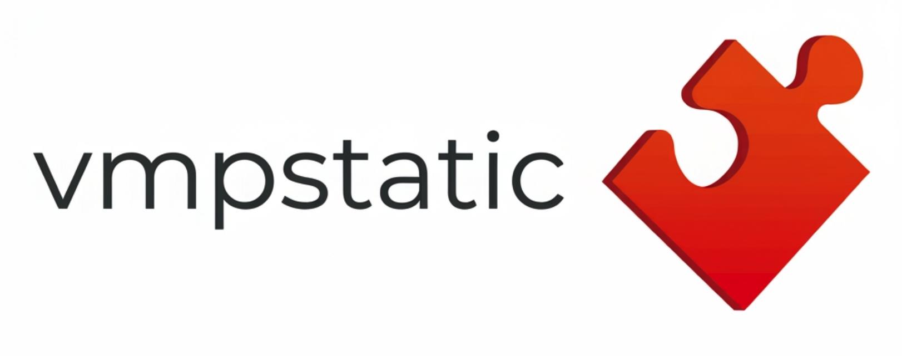

# vmpstatic

**Static VMProtect triage and PE layout reconstruction.** `vmpstatic` inspects PE files as
read-only bytes; it never executes, loads, or emulates the sample. It reports structural evidence
and can restore supported compressed sections into a normalized PE image for further analysis.

> This is a best-effort analysis tool, not a universal unpacker. Reconstructed output is not
> guaranteed to run. It does not rebuild imports or devirtualize code. See
> [Limitations](#limitations) before relying on its output.

## Features

- PE32 and PE32+ parsing with bounds checks, structural diagnostics, section entropy, overlays,
  and data-directory reporting.
- Evidence-based VMProtect detection and candidate entry-point analysis.
- Static VM structure hints: VM entry patterns, handler-table candidates, dispatcher candidates,
  coarse handler classification, and import reference sites (call/jmp/mov), plus vmpfix-shaped
  import-resolver stub cores.
- Rotating-XOR key recovery and structural parsing of encoded import tables, with optional export
  catalog cross-checking.
- Best-effort restoration of recognized legacy plaintext and rotating-key packed-section layouts
  using bounded raw LZMA decoding.
- Text and JSON reports; optional raw memory-image and forensic artifacts.
- Optional Capstone disassembly. Builds without Capstone use conservative opcode-pattern
  classification.

## Requirements

- CMake 3.16 or newer.
- A C11 and C++17 compiler (GCC, Clang, or MSVC).
- Optional: Capstone 5 development headers and library.

No network access or package download is required for the default build. The 7-Zip LZMA decoder
and its licensing information are included in `third_party/7zip_lzma/`.

## Build and test

```sh
cmake -S . -B build -DCMAKE_BUILD_TYPE=Release
cmake --build build --parallel
ctest --test-dir build --output-on-failure
```

When Capstone is installed and discoverable by CMake, the tool enables disassembly-based handler
classification. Otherwise, it reports that opcode-pattern fallback is in use. GitHub Actions
builds and runs the synthetic test suite on Linux, macOS, and Windows.

For a static Windows x64 cross-build using MinGW-w64, install `x86_64-w64-mingw32-gcc` and
`x86_64-w64-mingw32-g++`, then run:

```sh
scripts/build-mingw.sh
```

The script writes `build-win/vmpstatic.exe` by default. Pass a different output directory as its
first argument if needed.

## Usage

```sh
# Build output path is build/vmpstatic on single-configuration generators.
./build/vmpstatic --help
./build/vmpstatic --version
./build/vmpstatic inspect packed.exe
./build/vmpstatic inspect packed.exe --json
./build/vmpstatic inspect packed.exe --oep 0x140001000
./build/vmpstatic analyze packed.exe --report report.json
./build/vmpstatic analyze packed.exe --catalog ntdll.dll --catalog kernel32.dll
./build/vmpstatic unpack packed.exe normalized.exe --oep 0x1000
./build/vmpstatic unpack packed.exe image.bin --raw-dump
./build/vmpstatic unpack packed.exe normalized.exe --artifacts unpack-artifacts
```

The input path must end in `.exe` (case-insensitive). Normalized PE output must also end in
`.exe`; `--raw-dump` accepts a raw-image filename. `--catalog` accepts repeatable PE DLL paths
and uses their export tables to validate decoded encoded-import records and assign ordinals.
Records that no supplied catalog exports are dropped and counted. `--oep` accepts an RVA or a VA;
values at or above the image base are interpreted as VAs.

`inspect` prints a report and writes no files unless `--report` is given. `analyze` prints a report
and writes JSON to `<input>.vmpstatic.json` by default. `unpack` writes `<output>.analysis.json`
unless another report path is specified. Output paths are checked to prevent overwriting the
input.

### Reconstruction behavior

`unpack` expands the file to a zero-filled memory image, restores recognized compressed sections
when their metadata validates, rewrites section raw-data offsets and sizes, patches
`AddressOfEntryPoint`, and writes the normalized PE plus a JSON report. It does **not** rebuild
imports, relocations, TLS, or resources. Any Authenticode signature is invalidated by modifying
the image. Treat output as an analysis artifact, not as a runnable executable.

`unpack --raw-dump` writes the restored memory-layout bytes without PE header repairs or an OEP
patch. `--artifacts <dir>` additionally saves the selected candidate, compressed/decompressed
blocks, and a copy of the JSON report. Do not use these options on files you are not authorized to
analyze; generated artifacts can contain the sample's original data.

## Report contents

- **PE facts:** format, image base, entry point, data directories (including the file-offset
  semantics of the certificate table), section attributes and entropy, overlays, and best-effort
  structural warnings.
- **Detection:** weighted signals, evidence, confidence, and a version only when a literal banner
  is found. A lone `VMProtect` string intentionally provides weak evidence.
- **Entry-point candidates:** original entry point, supported relative-branch patterns,
  section-start prologues, CRT startup signatures (x86 SEH, call+jmp), and
  security-cookie-anchored `mainCRTStartup` recovery, ranked by confidence.
  Supply `--oep` to override selection.
- **VM structure:** candidate VM entries, handler-table runs, dispatchers, and coarse categories
  such as arithmetic, memory, call, branch, and return. Classifications are heuristic.
- **Imports:** parsed PE imports, statically resolved indirect call/jump sites (including
  REX-prefixed thunks and `mov reg,[mem]` loads), vmpfix-shaped resolver stub cores
  (contiguous `lea/mov/lea` triples, report-only), recovered string keys, and structurally
  located encoded-import tables.
- **Packed sections:** candidate metadata and per-block recovery status.
- **Limitations:** included in every report.

## Limitations

Static heuristics can produce false positives and false negatives, and unsupported or ambiguous
metadata is reported rather than guessed. Handler classes are coarse instruction categories,
not recovered VM semantics. The project does not provide a VM CPU model, bytecode decoding,
IR/SSA lifting, import reconstruction, or general PE repair for relocations, TLS, resources,
and other loader-dependent structures. Compressed-section recognition is limited to documented
layouts implemented by this project and is not guaranteed to cover all VMProtect versions.

The input is read as bytes only. The program does not call `LoadLibrary`, create a process, invoke
a debugger, emulate instructions, or execute the sample. Keep samples and generated artifacts in
an isolated location and follow applicable authorization and malware-handling policies.

## Attribution and licensing

The project is licensed under MIT; see [`LICENSE`](LICENSE). The packed-section metadata port is
attributed in [`third_party/VMPStatic-Go-MIT.txt`](third_party/VMPStatic-Go-MIT.txt). The included
7-Zip LZMA decoder is public domain; see its source headers and
[`third_party/7zip_lzma/README.md`](third_party/7zip_lzma/README.md). Verify all third-party
attributions and license obligations before redistributing binaries.

Other projects were reviewed for publicly described techniques, as documented below. Their code
is not included in this project:

| Project | Technique informing the implementation |
|---|---|
| [can1357/NoVmp](https://github.com/can1357/NoVmp) | Static VM structure analysis ideas; devirtualization remains out of scope. |
| [wallds/NoVmpy](https://github.com/wallds/NoVmpy) | Section and entry-point heuristic references. |
| [fjqisba/VmpHelper](https://github.com/fjqisba/VmpHelper) | Handler identification and API-call analysis concepts. |
| [archercreat/titan](https://github.com/archercreat/titan) | Dispatcher-table analysis concepts. |
| [sh4m2hwz/devirt_vmp](https://github.com/sh4m2hwz/devirt_vmp) | Bytecode-extractor framing; bytecode decoding is not implemented. |

## Project layout

```text
src/                PE parser, analysis modules, CLI, and report generation
 tests/             Synthetic PE fixtures and regression tests
third_party/        LZMA decoder and attribution/license notices
scripts/            Optional MinGW cross-build helper
.github/workflows/  Cross-platform build and test workflow
```

Contributions should preserve the static-only boundary and include regression tests for behavior
changes. The test suite uses synthetic fixtures and does not execute sample files.
